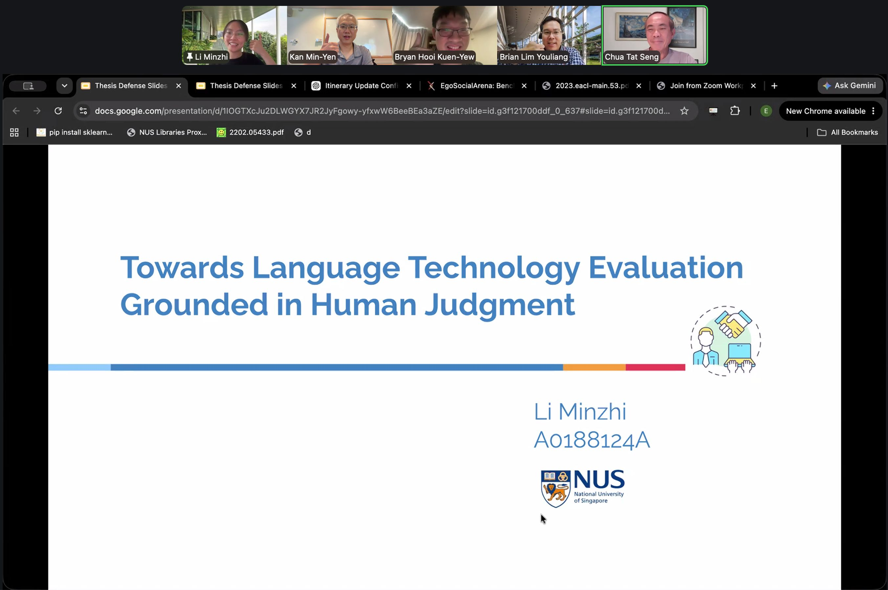

Congratulations to Dr Minzhi Li (Ella) on successfully defending her thesis, *Towards Language Technology Evaluation Grounded in Human Judgement*.

<!--more-->

Ella's thesis examines how language technology evaluation can better reflect human judgments and real-world interaction. Her work spans human-centred evaluation of large language models, social intelligence evaluation, LLM-as-a-judge methods, and evaluating large audio models through user preferences. Across these areas, she developed methods to bring automatic evaluation closer to human judgment.

Ella defended her thesis on 12 August 2026. Her co-advisors were Dr Nancy F. Chen, Prof. Shafiq Joty, and Prof. Diyi Yang. Her examiners were Profs. Tat-Seng Chua, Brian Lim, and Bryan Hooi. She is now joining industry as a WING alumna.

