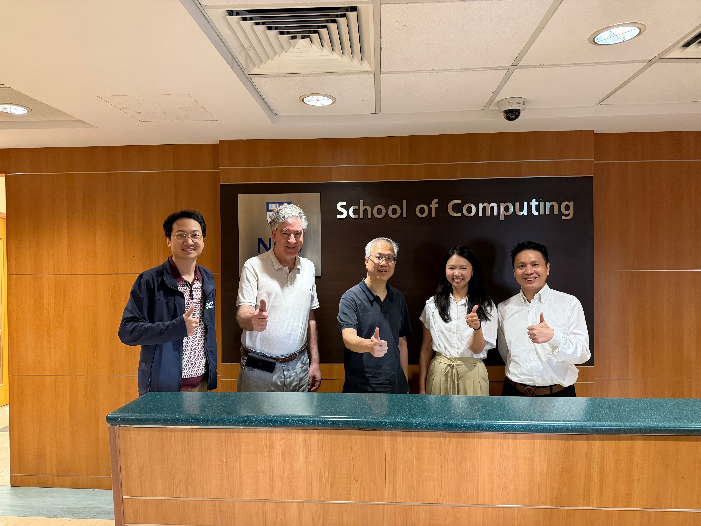
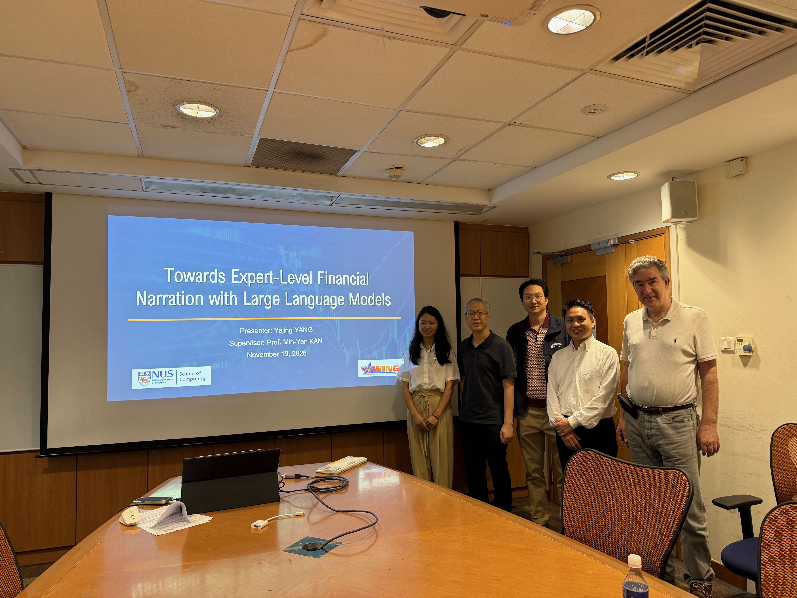

An AI can pass a financial exam, but can it explain what the markets are doing? Dr Yajing Yang's PhD research tackles the gap between fluent financial writing and the grounded, data-specific analysis experts use to guide investment decisions.

<!--more-->

Congratulations to [Yajing Yang](https://yajingyang.github.io/) on successfully defending her thesis, *Towards Expert-Level Financial Narration with Large Language Models*, on 19 Nov 2026! Supervised by [Min-Yen Kan](https://www.comp.nus.edu.sg/~kanmy/), Yajing conducted her research in collaboration with [Kelvin Koa](https://wing.comp.nus.edu.sg/author/kelvin-koa/) and [Yunshan Ma](https://mysbupt.github.io/).

Financial narration turns market data into analytical reports, but expert reports take time and resources to produce. Yajing's thesis shows that language models can generate fluent prose while missing the analytical operations that the data calls for. It presents three contributions that address this gap:

- **DataTales** pairs 4,900 professional financial reports with market data to measure analytical depth and factual accuracy. In its evaluation, no tested model exceeded 30% factual accuracy.
- **KAHAN** separates data retrieval, computation, reasoning and writing into hierarchical analytical stages. It improved narrative quality by 20–25% while achieving 98% factuality in the reported financial evaluation.
- **AnalysisBank** draws analytical patterns from expert reports and retrieves those suited to the input data, increasing novel, grounded insight by 1.7–3.7 times in the thesis evaluations.

The thesis also explores applications beyond finance, including Parkinson's disease gait analysis and scientific writing, showing how expert analytical practice can inform data-grounded generation in other domains.

We thank Yajing's PhD committee, [Huang Ke-Wei](https://www.comp.nus.edu.sg/disa/people/huangkw/), [Jingxian Wang](https://wangwireless.com/) and [Roger Zimmermann](https://www.comp.nus.edu.sg/cs/people/rogerz/), for their time and guidance. Congratulations, Yajing!

